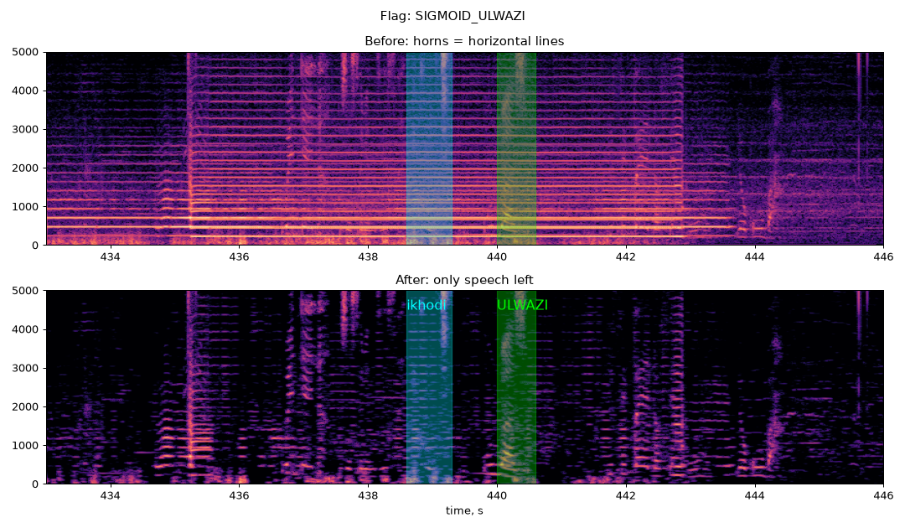

# Ngiyakuzwa? — `SIGMOID_ULWAZI`

1. **Noise:** the spectrogram is full of horizontal lines — stadium horns playing the same notes for seconds.
2. **Cleaning:** the typical (median) level of each frequency over ~2 s is the horn noise; subtract it from the whole recording → `clean.wav`.
3. **Listening:** listened to the whole cleaned recording waiting for *ikhodi*. At 7:18–7:21 she says "... uzosebenzisa **ikhodi** **ulwazi** ..." ("you will use the code ULWAZI").
4. **Flag:** word after *ikhodi* = ULWAZI → `SIGMOID_ULWAZI`.

