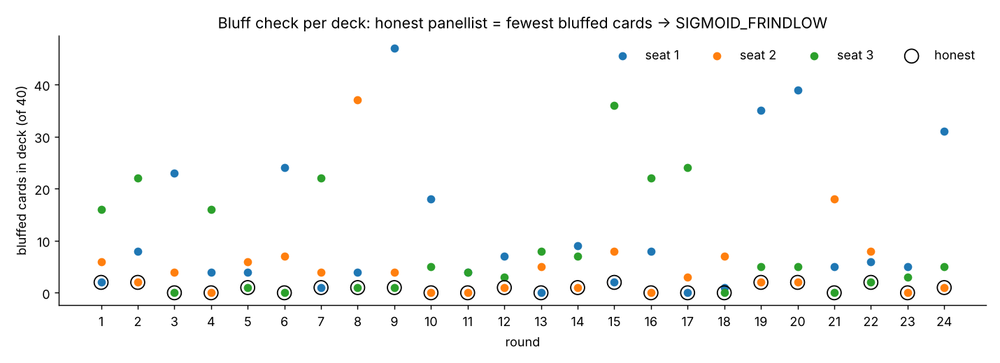

# Call My BLEUff

Flag: `SIGMOID_FRINDLOW`

## How the bluffers game BLEU

The house scorer (`bleu.py`) is corpus-level BLEU-4 with five references per card. Its configuration leaves several
doors open, and every bluffer uses one or more of them. Examples below are real descriptions from `panel.csv`.

1. Truncation. Write a short description that leaves out most facts. Almost every word of a short generic sentence
   matches some reference, so precision goes up. The brevity penalty is computed once for the whole deck from the
   closest reference length of each card, so a short output is compared with the shortest reference and is
   barely penalised; long cards elsewhere in the deck pay back the rest.
   "Near Ranch is The Cricketers." / "In the riverside area there is a pub serving Italian food." (no venue name)

2. Padding. Repeat phrases or whole sentences that appear in the references. Clipping is per reference, so repeats
   still add matched n-grams up to the clip, and they make the deck longer to cancel the brevity penalty of the
   truncated cards.
   "There is kids-friendly Fast food restaurant rated 1 out of 5 named The Rice Boat at the riverside. The Rice Boat
   at the riverside is kids-friendly Fast food restaurant rated 1 out of 5."

3. Splicing. Glue fragments of different references together without grammar. Each fragment keeps its 2-4-gram
   matches with the reference it came from, while the sentence stops making sense.
   "Zizzi is an with Indian food, has a pub with is highly rated high customer Rating."

4. Wrong facts. Spliced or copied phrases bring in facts that do not belong to the card (BLEU counts shared words,
   not truth).
   "There is a cheap coffee shop located near Café Sicilia ... provides sushi" (the card: average price).

5. Copying. Reproduce a reference almost verbatim. The heavy copiers do it on 14-19 of their 40 cards.

BLEU rewards all of this, so in every round the producers crowned a bluffer (the baseline spells SKELDRAP).

## The proposed check

A listener would ask two questions about a description: is it true and complete, and is it normal prose?
The check answers them per card.

- Facts of the card: venue name, type, food, price, rating, area, family-friendliness and the landmark nearby are
  detected with keyword patterns in each of the five references; a value counts as a fact of the card if at least
  three references agree (`facts.py`).
- A card is a bluff if any of these holds (`check.py`):
  - contradiction: the description states a fact with a different value;
  - truncation: it states less than 80% of the card's facts, or leaves out the venue name;
  - padding: a three-word phrase (names excluded) is repeated;
  - splice: two function words are glued in a way that never occurs in any of the 4,800 references ("a is", "an with");
  - copying: at least 80% of the description is one run copied from a reference. A few such matches occur in honest
    decks too (the guide itself repeats some descriptions), so copying counts only for decks that do it on more than
    5 cards.
- Deck score = number of bluffed cards. The honest panellist is the deck with the fewest.

## Evidence



Bluffed cards per deck (of 40), seats 1 / 2 / 3, and the honest seat:

```
round  1:  2  6 16  -> seat 1        round 13:  0  5  8  -> seat 1
round  2:  8  2 22  -> seat 2        round 14:  9  1  7  -> seat 2
round  3: 23  4  0  -> seat 3        round 15:  2  8 36  -> seat 1
round  4:  4  0 16  -> seat 2        round 16:  8  0 22  -> seat 2
round  5:  4  6  1  -> seat 3        round 17:  0  3 24  -> seat 1
round  6: 24  7  0  -> seat 3        round 18:  1  7  0  -> seat 3
round  7:  1  4 22  -> seat 1        round 19: 35  2  5  -> seat 2
round  8:  4 37  1  -> seat 3        round 20: 39  2  5  -> seat 2
round  9: 47  4  1  -> seat 3        round 21:  5 18  0  -> seat 3
round 10: 18  0  5  -> seat 2        round 22:  6  8  2  -> seat 3
round 11:  4  0  4  -> seat 2        round 23:  5  0  3  -> seat 2
round 12:  7  1  3  -> seat 2        round 24: 31  1  5  -> seat 2
```

In every round one deck has 0-2 flagged cards, and the flags it does get are ordinary human slips (typos, an odd
comma). The other two decks show a bluffing pattern: one heavy bluffer (truncation, copying, padding or splicing on
most cards) and one light bluffer (a handful of truncated or padded cards, e.g. round 18 seat 1 repeats a whole
sentence once). The choice does not change when the thresholds are varied (length/coverage limits for truncation,
0.8 / 0.9 / 1.0 for copying): every variant gives the same 24 seats.

Seats of the honest panellist: 1 2 3 2 3 3 1 3 3 2 2 2 1 2 1 2 1 3 2 2 3 3 2 2.
As base-3 digits (seat - 1), three rounds per letter, 9*d1 + 3*d2 + d3:

```
rounds  1-3 : 0 1 2 ->  5 -> F
rounds  4-6 : 1 2 2 -> 17 -> R
rounds  7-9 : 0 2 2 ->  8 -> I
rounds 10-12: 1 1 1 -> 13 -> N
rounds 13-15: 0 1 0 ->  3 -> D
rounds 16-18: 1 0 2 -> 11 -> L
rounds 19-21: 1 1 2 -> 14 -> O
rounds 22-24: 2 1 1 -> 22 -> W
```

Flag: `SIGMOID_FRINDLOW` (accepted by the platform).

## Files

- `bleu.py`, `baseline_solution.py`, `dataset/` - from the task
- `facts.py` - recovers each card's facts from its references and checks a description against them
- `check.py` - the proposed check: per-card verdict with reasons, deck scores, honest seat per round
- `figure.py` - deck scores, the plot `bluff_check.png`, the table `deck_scores.csv` and the word
- `card_verdicts.csv` - every description with its verdict and the reasons

## How to reproduce

Python 3.10+, pandas and matplotlib.

```
pip install pandas matplotlib
python baseline_solution.py     # what BLEU picks: SKELDRAP
python check.py                 # per-card verdicts -> card_verdicts.csv, deck scores per round
python figure.py                # bluff_check.png, deck_scores.csv, prints SIGMOID_FRINDLOW
```
